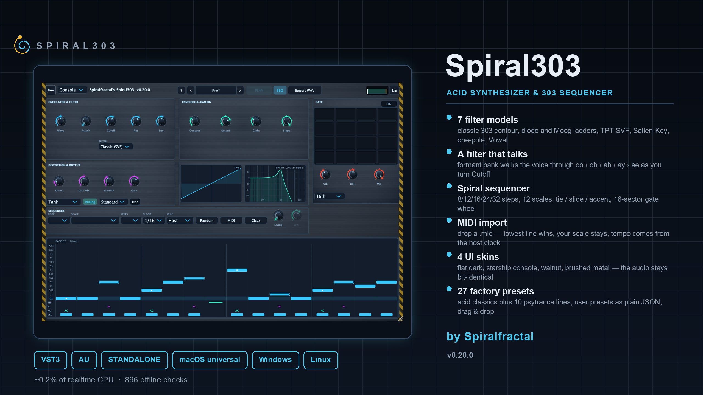
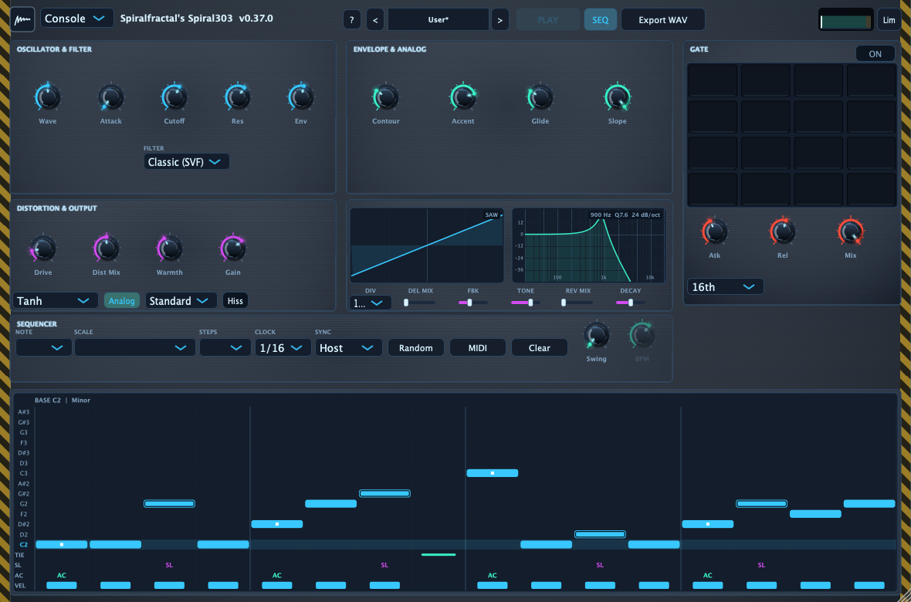
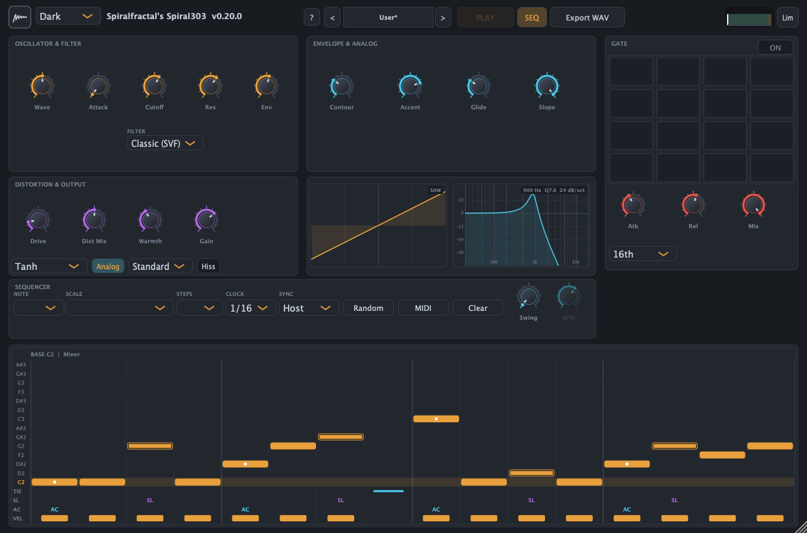
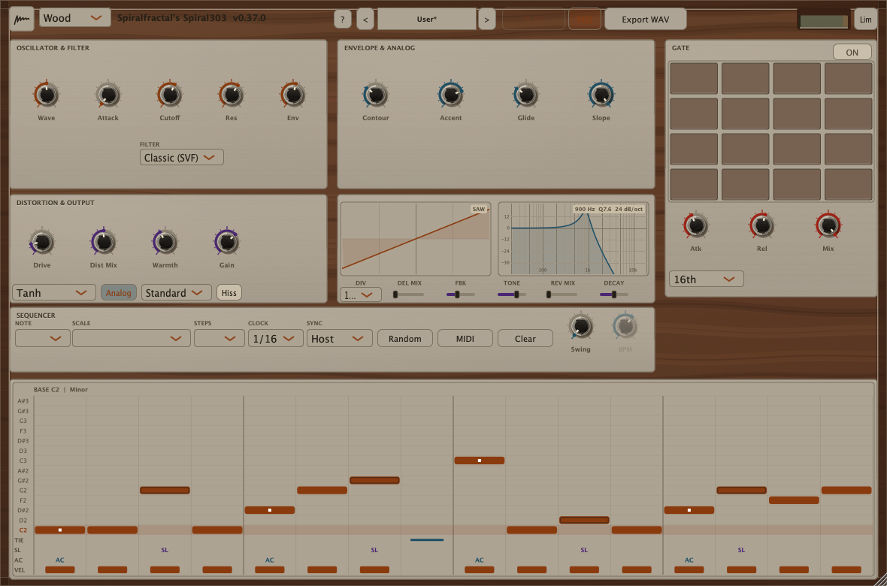
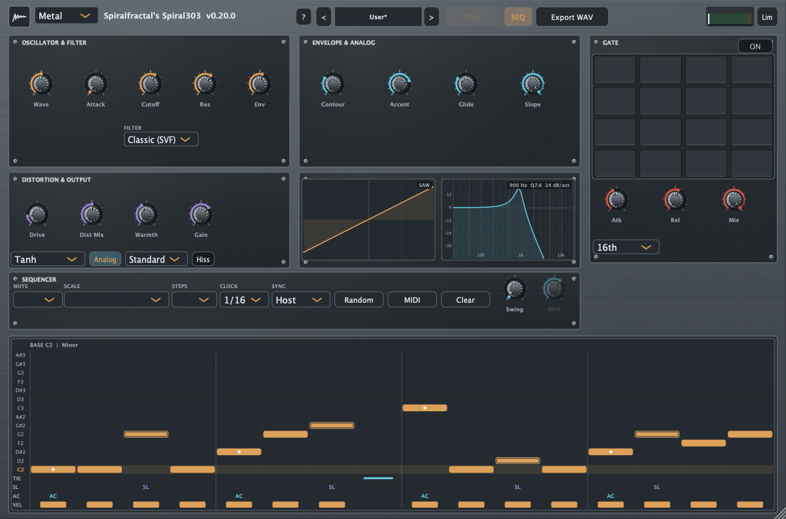
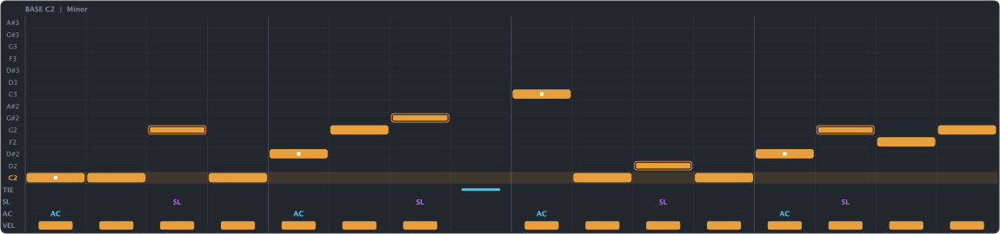
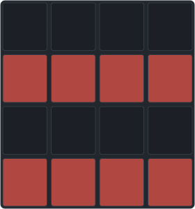

<div align="center">



# Spiral303

**A Roland TB-303 acid line that can talk — eight filter models, one of them a formant bank that pronounces a vowel as you turn Cutoff.**

[](https://github.com/Spiralfractalplugins/spiral303/releases/latest)
[](#downloads)
[](#formats)
[](https://github.com/Spiralfractalplugins/spiral303/actions/workflows/ci.yml)
[](LICENSE)
[](https://juce.com/)

[**Downloads**](#downloads) · [Building](docs/BUILDING.md) · [WebAssembly](docs/WEBASSEMBLY.md) · [Registry publishing](docs/PUBLISHING.md) · [Changelog](CHANGELOG.md) · [README (RU)](README_ru.md)

</div>

---

Every note of Spiral303 goes through the chain that made the 303 a genre: a
morphing oscillator, a resonant contour filter whose cutoff is swept by the note
envelope, accent, glide and a step sequencer where each step carries a tie, a
slide and an accent. Then it grew: eight filter models instead of one, a formant
bank that turns the cutoff knob into a mouth, a 16-sector gate wheel, tape and
tube saturation, a tempo-synced delay and a small room, analogue drift, and a
browser build that is the same DSP as the native one.



## Downloads

Prebuilt bundles are in the [**latest release**](https://github.com/Spiralfractalplugins/spiral303/releases/latest):

| Package | Contents |
| ------- | -------- |
| `Spiral303-<version>-macOS.zip` | VST3 + AU + LV2 + Standalone (universal `arm64;x86_64`) |
| `Spiral303-<version>-Windows.zip` | VST3 + LV2 + Standalone |

CLAP and the Linux packages are built from source — the release workflow ships
macOS and Windows only, and the `.clap` needs `clap-juce-extensions` in
`vendor/`. The WebAssembly bundle is built with `tools/build_wclap.sh` and served
from the [plinken shelf](https://plinken.org/shelf.json); see
[WebAssembly](#webassembly-wclap). See [Building](docs/BUILDING.md) for the rest.

## Formats

- **VST3** — macOS, Windows, Linux
- **AU** — macOS
- **CLAP** — all three platforms, via [clap-juce-extensions](https://github.com/dsp56300/clap-juce-extensions) (`com.spiral303.plugin`)
- **LV2** — all three platforms, including the native editor (`ui:CocoaUI` / `ui:WindowsUI` / `ui:X11UI`) and the 102 presets as `pset:Preset`
- **Standalone** application — no host needed, for checking the sound
- **WCLAP** — the CLAP plug-in compiled to `wasm32`: one file that runs in a browser and in native DAWs through [wclap-bridge](docs/WEBASSEMBLY.md)

## Highlights

- **Eight filter models**, all loudness-calibrated against the classic one, so
  switching never deafens you or drops you to silence: 303 contour (12/24 dB/oct),
  diode ladder, Moog ladder, TPT SVF, Sallen-Key, one-pole, **Vowel**, and an
  asymmetric diode 303 whose resonance is stronger in the low register.
- **A filter that speaks.** Vowel is three parallel formant resonators (F1/F2/F3).
  Cutoff is mouth position (150 – 4200 Hz), Resonance is formant width, and the
  note envelope moves the mouth by itself: bright on the attack, dark in the tail,
  so each note pronounces `oo › oh › ah › ay › ee`.
- **Morphing oscillator** sine → saw → square on one knob, quadratic polyBLEP at
  both corners, DC blocker.
- **Twelve saturation types** — tanh, rational drive, triode, wavefolder, master
  clip, five tape models, clean and a ported crunchy stage — each with its own
  makeup-gain table, and an ~8 ms crossfade when you change type.
- **303 sequencer**: 4 – 32 steps, 12 scales, tie / slide / accent per step,
  chained accents that charge each other up to +75% like the accent capacitor in
  a real 303, swing and glide. A REC switch runs serial step entry: notes you
  play land in the grid one by one at the glowing record cursor, snapped to the
  scale — velocity 100+ records the accent, a second held note makes the step
  slide, a sustain-pedal tap (CC64) records a rest.
- **Gate wheel**: a 4×4 grid where each cell is a 16th note; closed cells mute the
  gate layer, rotating the pattern shifts it by a step, with its own attack,
  release, level and clock division (16th / 8th / 32nd / 16T).
- **MIDI in and out of the pattern**: drop a `.mid` on the window and the lowest
  line lands in the sequencer, snapped to your scale; export writes the pattern
  back as a standard `.mid` that imports to the same steps; and while the
  sequencer runs, the playing line also leaves the plug-in as note events to the
  host, at the very samples the voice fires, with the accent riding in velocity
  exactly the way the export writes it.
- **Analogue behaviour**: Warmth adds pitch and cutoff drift, fluctuations and
  gate-threshold spread; a noise floor can be switched on.
- **Master limiter** with a continuous knee, threshold and ceiling, plus a
  post-limiter meter with peak, RMS and gain-reduction.
- **FX tail**: a tempo-synced analogue delay (fractional readout, low-pass in the
  feedback loop) and a Schroeder room, both skipped at zero mix.
- **Scope** with the filter's magnitude response under the main knobs — the
  response pane is itself a control: drag it to set cutoff and resonance.
- **102 factory presets** (acid, acid house, goa, including well-known lines) and
  user presets as plain JSON with drag & drop.
- **Four UI skins** — flat dark, starship console, walnut, brushed metal — with
  deterministic textures. A skin changes paint only; the audio stays bit-identical.
- **WAV export** of the current pattern through the full chain, plus a two-bar preview.

## Four skins

Same window, same pixels of audio — the skins are paint only, and the test suite
asserts that a render is bit-identical across all four.

| Dark | Console |
| --- | --- |
|  |  |
| **Wood** | **Metal** |
|  |  |

The sequence grid and the gate wheel, up close:




<details>
<summary><b>Full feature list</b></summary>

## Sound engine

- **`WaveOsc`**: one knob morphs sine → saw → square; quadratic polyBLEP at both
  corners (phase wrap, and the square's transition through 0.5), DC blocker.
- **`ResonantFilter`**: the classic TB-303 contour with envelope-on-cutoff, 12 and
  24 dB/oct crossfaded by Slope; TPT SVF and Sallen-Key are zero-delay.
- **Loudness calibration**: the non-classic models are matched to the Classic
  anchor by a table over log-cutoff × resonance, interpolated, capped, so no model
  is more than ~6% louder.
- **Vowel**: three band-pass resonators at 80/90/120 Hz reference spacing, weights
  proportional to frequency, a one-pole in front (−6 dB/oct source tilt),
  coefficients refreshed every 16 samples with a ramp and a snap — bit-exact while
  nothing moves. Its own 14×9 loudness table.
- **`Saturation`**: tanh drive with pre-gain and level compensation, parallel
  DistMix, five tape curves (Jiles–Atherton), a Clean bypass and a Crunch port
  (clamp → even stage → odd stage `1−(1−|x|)^p`, DC blocker at 20 Hz, clamp ±4).
  Tape → tape keeps the magnetisation state; switching types crossfades the wet
  signal over ~8 ms.
- **Voices**: `TbVoice` fades the edge of every note (2 ms up, 1 ms down, half a
  cosine) and queues a note that arrives over a sounding one, starting it from
  zero — no clicks on fast lines, and the filter state is never reset between
  notes, so the resonance keeps ringing.
- **`Engine`**: sliding envelope, accent, glide, analogue drift (`Drift` wraps its
  clock modulo 628 s so pitch cannot wander after hours of running), an optional
  `AnalogHiss` noise floor, live MIDI notes played while the sequencer is stopped,
  and a ~18 Hz DC blocker on the output.
- **`Limiter`**: peak follower plus a tanh ceiling with a 6 dB continuous knee;
  quiet blocks skip it entirely.

## Sequencer

- Step codes are a bit field: rest, tie, `128 + degree`, `+256` slide, `+512`
  accent; 12 scales; 4 – 32 steps; base note 24 – 72.
- Accent raises level and kicks the filter; consecutive accents stack 1 : 1.25 :
  1.5 : 1.75 and a rest or a plain note resets the chain.
- Clock from the host transport or manual BPM 20 – 400, divisions 1/4 … 1/16T,
  swing on even steps, gate divisions of its own.
- `GatePattern`: 16 sectors plus rotation, serialised as `g1:<HEX>:<rotation>`,
  `GateRamp` (1.5 ms floor) and `GateMix` for dry/wet.

## Presets

- 102 factory presets embedded at build time: 27 originals, 25 goa lines in
  phrygian, 25 acid techno, 25 acid house.
- User presets are ordinary JSON files in the app-support folder — editable by
  hand, saved from the UI, renamed and deleted from the preset menu, dropped onto
  the window. Format is documented in [presets/README.md](presets/README.md).

## Editor

- One window, 1180×780 design units, scaled to the width you give it
  (300 / 700 / 1180 px breakpoints), faders and knobs sized by their cell.
- The preset field in the header is the browser: click to rename, right click for
  the bank menu, ←/→ to page through, and the credit column shows the preset note.
- `SequenceEditorComponent` — the spiral grid with TIE/SL/AC rows and a per-step
  popup; velocity-drag across the note bar paints a line in one sweep.
- `GateCircleComponent` — the 4×4 gate grid with rotation by dragging.
- `ScopeComponent` — waveform (analytic, from the Wave knob) plus the filter's
  response, both on the same log-frequency/dB axes as the plug-in's own maths.
- Four skins, textures generated from a seeded RNG so offline renders are
  reproducible; the dark skin is flat and unchanged since 0.x.

## WebAssembly page

The wasm build ships a canvas editor that is a port of the native editor, not a
look-alike: the same geometry, the same menus, the same gestures (velocity-drag,
wheel steps, relative response drag), the same skin textures, user presets in
`localStorage`, SMF parsing for MIDI import and offline WAV rendering.

</details>

## Quick start (from source)

Requirements: CMake 3.24+, a C++17 compiler, JUCE 8.0.14 and
clap-juce-extensions (both fetched into `vendor/`, which is not committed):

```sh
git clone --depth 1 --branch 8.0.14 https://github.com/juce-framework/JUCE.git vendor/JUCE
git clone https://github.com/dsp56300/clap-juce-extensions.git vendor/clap-juce-extensions
git -C vendor/clap-juce-extensions checkout e1f67893cc409a40c1154fa2e78c97046da24ce0
git -C vendor/clap-juce-extensions submodule update --init --recursive

cmake -S . -B build
cmake --build build --config Release
```

Artefacts land in `build/Spiral303_artefacts/Release/` as `VST3/`, `AU/`, `LV2/`,
`CLAP/` and `Standalone/`. On macOS the built plug-ins are also copied next to the
artefacts and into the system folders (`~/Library/Audio/Plug-Ins/…`, CLAP and LV2
included). LV2 needs no extra dependency — JUCE 8 builds the bundle itself.

Windows and Linux do not need matching machines:
`tools/windows-cross-build/cross-build.sh` compiles the Windows VST3/LV2 with MSVC
under Wine and the Linux VST3/CLAP/LV2 natively in an amd64 container, then runs
the render test suite on the produced PE binary.

Per-platform requirements, what the container scripts work around, and how the
LV2 `patch:` automation limitation looks in practice:
[docs/BUILDING.md](docs/BUILDING.md).

> Spiral303 is GPLv3 — the same copyleft family as JUCE's open licence. If you
> ship a closed-source product built on this code, review the JUCE licensing
> terms for your use case.

## Tests

The test target is a console app: the whole sequencer and DSP run offline without
an audio device, and the GUI is checked pixel by pixel into `Image`s.

```sh
cmake --build build --config Release --target Spiral303Tests
./build/Spiral303Tests_artefacts/Release/Spiral303Tests    # Windows: .exe
```

It must print `ALL TESTS PASSED`. The suite:

- `tests/TestRender.cpp` — DSP and sequencer scenarios, including spectral checks
  on the filter models and the vowel trajectory;
- `tests/TestCoverage.cpp` — parameter extremes, broken files, refused writes,
  MIDI import, and a walk over the whole preset bank: every preset is loaded
  through `setCurrentProgram` and rendered;
- `tests/TestGui.cpp` — pixel assertions for every control and skin, plus the
  screenshots in `docs/screenshots/`;
- `tests/TestStability.cpp` — a soak over all eight filter models and twelve
  saturation types;
- `tests/TestCoreParity.cpp` — the JUCE-free core used by the wasm build, compared
  sample for sample against the native one.

GUI screenshots are written to the system temp folder (`%TEMP%/spiral303_gui/`).
The standalone app cannot be driven by clicks in CI: the modal preset menu zeroes
`MainWindowHandle`, so clicks would land in another window.

## Parameters

41 parameters, in host order (AUv2 keeps these indices, so new ones are only ever
appended). Values are the engineering units the UI shows.

| ID | Type | Range / choices | Default |
| --- | --- | --- | --- |
| `Cutoff` | float | 40 – 8000 Hz (log) | 900 Hz |
| `Wave` | float | 0 – 1 (sine → saw → square) | 0.5 |
| `Res` | float | 0 – 1 | 0.62 |
| `EnvAmt` | float | 0 – 1 | 0.55 |
| `Contour` | float | 0.05 – 1.5 (fraction of a step) | 0.5 |
| `Accent` | float | 0 – 1 | 0.75 |
| `Glide` | float | 0 – 1 | 0.3 |
| `Drive` | float | 0 – 1 | 0.15 |
| `DistMix` | float | 0 – 1 (wet share) | 0.5 |
| `Slope` | float | 0 – 1 (12 → 24 dB/oct) | 1.0 |
| `Warmth` | float | 0 – 1 | 0.4 |
| `Swing` | float | 0 – 0.6 (fraction of a step) | 0.0 |
| `BPM` | float | 20 – 400 BPM (log) | 130 BPM |
| `ClockDiv` | choice | 1/4 / 1/4T / 1/8 / 1/8T / 1/16 / 1/16T | 4 (1/16) |
| `Sync` | choice | Host / Manual / Midi Clock | 0 (Host) |
| `GateDiv` | choice | 16th / 8th / 32nd / 16T | 0 (16th) |
| `GateOn` | bool | — | false |
| `Play` | bool | — | true |
| `GateMix` | float | 0 – 1 | 1.0 |
| `GateAtk` | float | 0.2 – 50 ms (log) | 2 ms |
| `GateRel` | float | 0.5 – 200 ms (log) | 14 ms |
| `Gain` | float | −24 – +12 dB | 0 dB |
| `SatType` | choice | Tanh / Drive (Rational) / Triode (Tube) / Fold (Wavefolder) / Master Clip / Tape / Tape Warm / Cassette / Reel (Hi-Fi) / Tape (Hot) / Clean / Crunch | 0 (Tanh) |
| `AnalogOn` | bool | — | true |
| `AnalogMode` | choice | Standard / Moog Thick / Virus Hyper | 0 (Standard) |
| `AnalogHiss` | bool | — | false |
| `FilterType` | choice | Classic (SVF) / Diode Ladder (303) / Moog Ladder / TPT SVF / Sallen-Key / One-Pole / Vowel / Diode 303 (Asym) | 0 (Classic) |
| `SeqOn` | bool | — | true |
| `LimOn` | bool | — | false |
| `LimThr` | float | −20 – 0 dB | −1 dB |
| `LimCeil` | float | −6 – 0 dB | −0.2 dB |
| `Attack` | float | 0 – 1 → 0 – 1.22 s (`0.02 + 1.2·x²`) | 0 |
| `MidiMap` | choice | Off / Launch Control / Launch Control XL / Push 2 | 0 (Off) |
| `FxDelMix` | float | 0 – 1 (0 skips the stage) | 0.0 |
| `FxDelDiv` | choice | 1/4 / 1/8 / 1/8. / 1/16 / 1/8T | 2 (1/8.) |
| `FxDelFb` | float | 0 – 0.9 | 0.35 |
| `FxDelTone` | float | 0 – 1 → 500 – 8000 Hz (log) | 0.65 (≈ 4.5 kHz) |
| `FxRevMix` | float | 0 – 1 (0 skips the stage) | 0.0 |
| `FxRevDecay` | float | 0 – 1 (comb gain 0.21 – 0.70) | 0.5 |
| `Oversample` | choice | OS Off / OS 2x / OS 4x | 0 (OS Off) |
| `UiSkin` | choice | Dark / Console / Wood / Metal (UI only) | 0 (Dark) |
| `Start` | choice | Transport / Note Trigger (reachable through the host's automation panel) | 0 (Transport) |

Parameters live in an `AudioProcessorValueTreeState`, so host automation and state
save/restore work in every format; the wasm build exposes the same IDs. The
sequence, the gate pattern and the pattern length/scale/base note travel in the
plug-in's own state rather than as parameters, and `UiSkin` is deliberately last
because the audio thread never reads it.

## How the sound is made

**1. The note.** The sequencer holds one bit-field per step — rest, tie, pitch as
a scale degree, plus slide and accent flags — and steps it at the host clock or at
the manual BPM, with swing pushing even steps late. A slide glides the pitch from
the previous note instead of re-attacking it; a tie extends the previous note
across the step.

**2. The voice.** `WaveOsc` produces the morphed waveform at the target pitch and
`polyBLEP` corrects each discontinuity as it is crossed, which is what keeps the
saw and the square from ringing. Accent multiplies the note's level and, more
importantly, hits the filter envelope harder; consecutive accents stack, the way
the accent capacitor in a 303 charges between fast notes.

**3. The contour filter.** Cutoff is the knob value plus the envelope scaled by
Env Amount, and Contour sets how fast that sweep falls relative to the step
length — this is the "acid" motion, and it is per note, not per bar. The eight
models are alternative answers to the same question (how does a 12/24 dB
resonant low-pass behave when the sweep is extreme), and all of them are matched
to the classic one by a measured loudness table, so a preset does not jump in
level when you switch.

**4. Vowel.** Instead of one resonance, three band-passes track the F1/F2/F3 formant
centres of a human voice, and Cutoff walks the bank along a measured trajectory:
`oo` low in the range, `oh`, `ah`, `ay`, `ee` at the top. Resonance narrows the
formants, so high Resonance is a clearer vowel rather than a howl. The note
envelope drives the same position, so a note starts bright and ends dark — the
line sounds like it is being sung, and the sequencer's accents are the consonants.

**5. The tail.** Saturation is a parallel mix, so DistMix at 0.5 leaves the dry
fundamental intact while the harmonics sit on top; each type has its own makeup
gain, and at Drive 0 the stage is exactly unity. Then the FX tail (delay, room),
the master gain, and the limiter, whose knee is continuous so it never switches
audibly at the threshold.

**6. The gate.** The 4×4 wheel is a second envelope: any closed cell mutes the
gate layer at that 16th, and its own attack/release/mix shape the chops. Rotation
shifts the figure against the clock, so one pattern gives four different grooves.

**7. The analogue part.** Warmth adds slow drift to pitch and cutoff, faster
fluctuations and a per-note spread of the gate threshold, all from a seeded RNG
that is reset with the engine, so a render is reproducible and a long set does not
go out of tune.

The scope draws the same maths the audio uses: the waveform is analytic from the
Wave knob, and the response curve is `ScopeAxes::responseDb`, the very formula the
filter applies — never a look-alike animation.

## WebAssembly (WCLAP)

The same DSP compiles to `wasm32` as a CLAP plug-in: one archive that runs in a
browser and in native DAWs through `wclap-bridge`. JUCE cannot build for wasm, so
the DSP sits in a JUCE-free core (`Source/core/JuceLite.h` — a small shim providing
clamps, strings, buffers and JUCE's own 48-bit LCG), and `TestCoreParity` proves
the two builds render bit-identical samples.

```sh
tools/build_wclap.sh          # sdk, build, bundle into dist/
wclap/tools/check_wclap.sh    # sound, API, page, archive, parity with native
```

The registry bundle is packed **flat** (`module.wasm` and the page at the root of
the tarball) because that is what browser hosts resolve; the openDAW build keeps a
`Spiral303.wclap/` top directory, so the two archives are not interchangeable.
Details — including the `clap.webview/3` draft extension the editor uses — are in
[docs/WEBASSEMBLY.md](docs/WEBASSEMBLY.md), and publishing to the public
[plinken shelf](https://plinken.org/shelf.json) in
[docs/PUBLISHING.md](docs/PUBLISHING.md).

## Repository layout

```
Source/dsp/                — oscillator, filters, saturation, voices, sequencer, limiter, FX, WAV
Source/gui/                — theme, knobs, scope, sequence editor, gate wheel, skins
Source/core/               — the mini-JUCE used to build for WebAssembly
Source/wclap/              — the CLAP layer of the wasm build
Source/PluginProcessor.*   — parameters (APVTS), transport, state
Source/PluginEditor.*      — window, preset menu, About
Source/Presets.*           — preset format, binary bank + user files
presets/                   — 102 factory presets (.json) and the format spec
web/                       — the WebAssembly page
wclap/                     — wasm module build, node test host, checks
tests/                     — TestRender (DSP), TestCoverage, TestGui (pixels), TestStability, TestCoreParity
docs/                      — building, WebAssembly, publishing, announcements
docs/screenshots/          — painted by the GUI tests
docs/marketing/            — social cards, generated by make_cards.py
```

## Versioning

The version is declared once — `project(Spiral303 VERSION ...)` in
`CMakeLists.txt` — and from there it reaches the VST3/AU manifests, the About box,
the test binary and the release artefacts. History: [CHANGELOG.md](CHANGELOG.md)
(Russian).

## Licence

GPL-3.0-only — see [LICENSE](LICENSE). JUCE (`vendor/JUCE`) is distributed under
GPLv3 or a commercial licence; when you publish a plug-in built on this code,
check the licence of the JUCE module you chose. The WCLAP bundle is the exception:
the wasm build does not link JUCE at all, so the archive in the plinken registry is
offered under Apache-2.0 — see [docs/PUBLISHING.md](docs/PUBLISHING.md).
